<picture>
  <source media="(prefers-color-scheme: dark)" srcset="assets/profile-dark.svg">
  <source media="(prefers-color-scheme: light)" srcset="assets/profile-light.svg">
  
</picture>

The skyline above is generated from my GitHub contributions and refreshed each week. If this repository has just been created, it will appear after the first **Update profile animation** workflow run.

Inspired by [KNN-07's profile](https://github.com/KNN-07).
